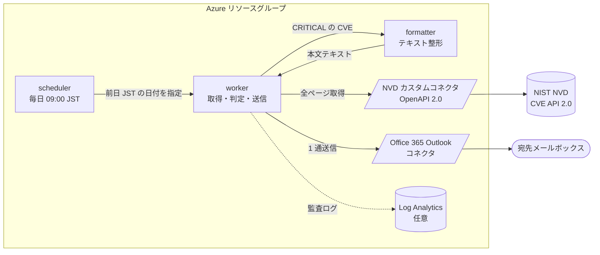
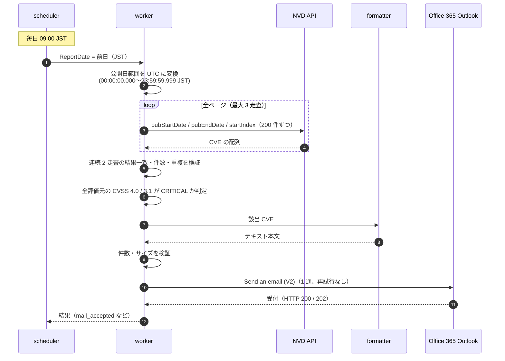
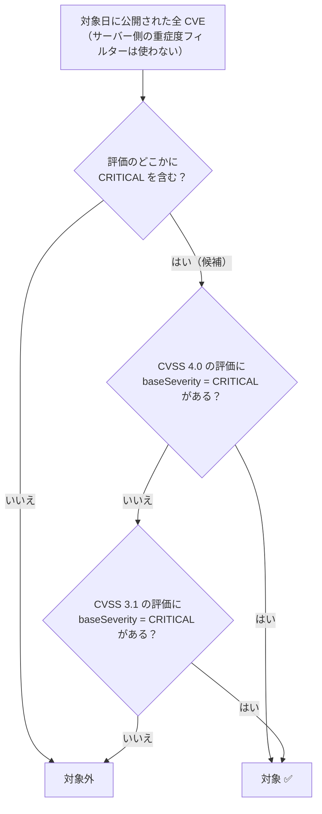

# NVD Critical Daily - Azure Logic Apps

**NVD（NIST National Vulnerability Database）に前日公開された CVE のうち、CVSS 4.0 または 3.1 が CRITICAL のものを、毎朝 9:00 (JST) に 1 通のメールで通知する** Azure Logic Apps (Consumption) のソリューションです。

[](https://portal.azure.com/#create/Microsoft.Template/uri/https%3A%2F%2Fraw.githubusercontent.com%2Fhisashin0728%2FNvdCriticalDailyLogicApp%2Fmain%2Fazuredeploy.json)

> ARM テンプレート 1 つをデプロイするだけで構築できます。Python / Azure Functions / ストレージ / LLM は不要です。
> すべて Logic Apps の標準アクションで動作します。

## 特長

| | |
|---|---|
| **全量取得** | 対象日に公開された CVE を **全ページ取得**し、連続 2 回の取得結果が一致したときだけ確定します。取りこぼしがあれば、メールを送らず失敗にします |
| **条件の網羅** | CVSS 4.0 **または** 3.1 が CRITICAL。Primary / Secondary など **すべての評価元**を判定します |
| **1 通で完全配信** | 件数が多くても省略・分割せず 1 通で送ります。送れない場合は理由を残して失敗します |
| **テキスト整形** | 件数、CVE、description、CVSS 4.0 / 3.1 の baseScore・baseSeverity、影響を受ける Vendor / Product / Version を全件記載します |
| **サーバーレス・低運用** | Logic Apps Consumption のみ。ストレージ・Key Vault・コード実行環境は不要です |
| **LLM 不使用** | AI のトークン上限による欠落は起こりません（決定的な処理です） |
| **セーフデフォルト** | デプロイ直後は「スケジュール無効・メール送信無効」。動作確認のあとに有効化します |

## 全体像



## 処理の流れ



### 対象 CVE の判定



> NVD のサーバー側フィルター（`cvssV3Severity` / `cvssV4Severity`）は NVD 自身（Primary）の評価しか見ないため、
> CNA などの Secondary 評価だけが CRITICAL の CVE を取りこぼします。実測では必要な 37 件のうち 35 件が漏れたため、
> 全件取得してから判定する設計にしています（[詳細](docs/OPERATIONS.md#全量性を担保する仕組み)）。

## メールの内容

件名: `NVD CRITICAL Daily 2026-10-20 JST (37 CVEs)`

本文（抜粋・値は説明用のサンプルです）:

```text
NVD CRITICAL Daily Vulnerability Report
Report date (JST): 2026-10-20
NVD collected at (UTC): 2026-10-21T00:05:12.3456789Z
Daily vulnerability count (distinct CVEs): 37
All published CVEs inspected: 516
Selection: CVSS 4.0 CRITICAL OR CVSS 3.1 CRITICAL (all assessment sources).
Completeness: all pages verified and two complete snapshots matched.
LLM used: false; token overflow: not applicable.

2026-10-20 #1 CVE-2026-12345 ------------------------------------------------------------------------
CVE: CVE-2026-12345
URL: https://nvd.nist.gov/vuln/detail/CVE-2026-12345
Published (NVD UTC): 2026-10-20T03:15:00.000
Last modified (NVD UTC): 2026-10-20T08:40:00.000
Description (full NVD text):
  [en] A sample remote code execution vulnerability in Example Widget ...
CVSS 4.0 assessments:
  baseScore: 9.3; baseSeverity: CRITICAL; source: example-cna; type: Secondary
CVSS 3.1 assessments:
  baseScore: 9.8; baseSeverity: CRITICAL; source: nvd@nist.gov; type: Primary
Affected Vendor / Product / Version (vulnerable CPE matches):
  Vendor: example / Product: widget / Version: *
    CPE: cpe:2.3:a:example:widget:*:*:*:*:*:*:*:*
    versionStartIncluding: Not specified
    versionStartExcluding: Not specified
    versionEndIncluding: Not specified
    versionEndExcluding: 2.4.1
...
```

- 各 CVE の区切り行に **対象日・連番・CVE ID** が入るので、件数や位置がひと目で分かります。
- NVD が提供しない項目は `Not provided by NVD` と明記し、推測で補いません。
- 件数 0 件の日も、取得を完全に確認できた場合は「0 件」のメールを送ります。
- Office 365 Outlook コネクタの制約により、本文は HTML（`<pre>` 内の等幅表示）として送られます。内容はテキストと同一です。

## デプロイ

### 前提条件

| 必要なもの | 補足 |
|---|---|
| Azure サブスクリプション | リソースグループに対する共同作成者（Contributor）以上 |
| NVD API キー | [無料で取得](https://nvd.nist.gov/developers/request-an-api-key)できます（キーなしは取得制限が厳しく、本構成では必須です） |
| 送信用の Microsoft 365 アカウント | メールを送れるメールボックス。**このアカウントでコネクタを承認**します（専用アカウントを推奨） |

### 手順

**1. デプロイする**

上の **Deploy to Azure** ボタンから、新規または既存のリソースグループを選び、次を入力します。

| パラメーター | 入力値 |
|---|---|
| `firstReportDate` | 対象にしてよい最古の公開日（例: デプロイ日の前日）`yyyy-MM-dd` |
| `senderMailbox` | 送信元アドレス（手順 2 で承認するアカウント） |
| `recipientEmail` | 宛先アドレス（1 件） |
| `nvdApiKey` | NVD API キー（セキュア文字列） |
| `createOffice365Connection` | `true`（初回） |
| `logAnalyticsWorkspaceId` | 監査ログを送る既存ワークスペースの ID（任意。空なら作成しません） |

その他のパラメーターは既定値のままで動作します。**スケジュールとメール送信は無効の状態で作成されます。**

**2. Office 365 接続を承認する**

リソースグループ内の API 接続 `nvdcriticaldaily-office365-connection` を開き、
「API 接続の編集」→「承認」で送信元アカウントにサインインして保存します（状態が「接続済み」になれば完了です）。

**3. メールなしで動作確認する（preview）**

`nvdcriticaldaily-worker` の「トリガーの実行 → Run with payload」で、`{"ReportDate":"<前日の日付>"}` を指定して実行します。
NVD 取得から本文の作成までを行い、メールは送りません（`MailSendingEnabled=false` のため、実行は意図的に失敗表示になります）。
実行履歴の `Record_TEXT_Report` で本文を確認してください。処理には数分かかります。

**4. 実送信を 1 回テストして受信を確認する**

ロジックアプリのデザイナーで worker の「パラメーター」から `MailSendingEnabled` を `true` にして保存し、
手順 3 と同じ要領でもう一度実行します。**実際にメールが届くことを確認してください。**
（保存後の確認方法は [ガイド](docs/OPERATIONS.md#portal-でのパラメーター変更再デプロイ不要) を参照）

**5. スケジュールを有効化する**

`nvdcriticaldaily-scheduler` を「有効化」します。以後、毎日 09:00 JST に前日分が配信されます。

> Azure CLI でデプロイする場合:
>
> ```powershell
> az group create -n rg-nvd-critical-daily -l australiaeast
> az deployment group create -g rg-nvd-critical-daily -f azuredeploy.json `
>   -p firstReportDate=2026-10-20 senderMailbox=sender@example.com recipientEmail=recipient@example.com `
>   -p nvdApiKey=<YOUR-NVD-API-KEY> createOffice365Connection=true
> ```
>
> パラメーターファイルの例: [azuredeploy.parameters.example.json](azuredeploy.parameters.example.json)
> （キーはファイルに書かず、コマンドの入力か安全な入力経路で渡してください）

### 作成されるリソース

| リソース | 種類 | 役割 |
|---|---|---|
| `nvdcriticaldaily-scheduler` | Logic App (Consumption) | 毎日 09:00 JST に worker を起動 |
| `nvdcriticaldaily-worker` | Logic App (Consumption) | NVD 取得、検証、判定、整形の呼び出し、メール送信、監査記録 |
| `nvdcriticaldaily-formatter` | Logic App (Consumption) | CVE の全情報をテキストに整形 |
| `nvdcriticaldaily-nvd-api` | カスタムコネクタ | NVD CVE API 2.0 の OpenAPI（Swagger 2.0）定義 |
| `nvdcriticaldaily-nvd-connection` | API 接続 | NVD コネクタ（NVD キーは worker の SecureString で渡す） |
| `nvdcriticaldaily-office365-connection` | API 接続 | Office 365 Outlook（要・手動承認） |
| 診断設定 ×3（任意） | Microsoft.Insights | 各ワークフローの `WorkflowRuntime` ログを既存の Log Analytics へ転送 |

ストレージアカウント、Key Vault、Log Analytics ワークスペース、ロール割り当ては作成しません。
料金は Logic Apps Consumption のアクション実行数に応じた従量課金です（診断ログ転送を有効にした場合は Log Analytics の料金も発生します）。

## 設定の変更

| やりたいこと | 方法 |
|---|---|
| 宛先・送信元・メール送信の ON/OFF の変更 | worker のデザイナー →「パラメーター」（**再デプロイ不要**） |
| スケジュールの停止 / 再開 | `nvdcriticaldaily-scheduler` の無効化 / 有効化 |
| 特定の日を再送したい | worker の「Run with payload」で `{"ReportDate":"yyyy-MM-dd"}`（[手動再実行の注意](docs/OPERATIONS.md#送信結果と手動再実行)） |
| NVD キーの変更 | 再デプロイ（`createOffice365Connection=false`）で入力し直す |

## 運用上の注意

- **配達まで保証するものではありません。** コネクタが受け付けた（HTTP 200 / 202）ことと、宛先に届くことは別です。送信元テナントによっては、外部宛が Exchange Online に拒否される（例: `550 5.7.708`）場合があります。**初回は必ず実受信を確認してください。**
- **Office 365 接続はユーザー（委任）認証です。** パスワード変更・MFA・条件付きアクセスの変更で接続が切れることがあります。専用アカウントを使い、接続状態を定期的に確認してください。
- **自動の補完送信はありません。** 停止中や失敗した日は、手動で再実行します。同じ日を再実行すると、重複して送信される可能性があります。
- **結果が不明なとき（タイムアウトなど）は再送しません。** 実行履歴と Sent Items を確認してから、手動で判断してください。
- **メールが大きすぎる場合は失敗します。** 本文は省略・分割しません。設計上の上限は 3,000,000 バイトです（コネクタの上限は 1 通 49 MB）。
- **処理時間:** 公開 500 件規模の日で約 5 分、公開数が多い日はそれ以上かかります。09:00 ちょうどに届くことは保証しません。
- **NVD は時点固定の API ではありません。** 取得時点の評価を配信するため、後日の評価追加や公開日の訂正は自動では反映されません。

## セキュリティ

- NVD API キーは worker の **SecureString パラメーター**として保持され、実行履歴やログには出力されません。リポジトリにも含まれません。
- worker と formatter は **「他の Logic Apps からのみ呼び出し可」**に制限されており、署名付き URL が漏れても、curl などからの直接呼び出しは拒否されます。
- メールの宛先・送信元・本文は、呼び出し側から変更できません。
- Office 365 の承認アカウントの権限で送信されるため、**送信専用の最小権限のアカウント**を使ってください。
- 取り扱うデータは NVD の公開情報のみです。

詳細は [運用・設計ガイド](docs/OPERATIONS.md#呼び出し元の制限) を参照してください。

## リポジトリ構成

```text
.
├── azuredeploy.json                  # ARM テンプレート（Deploy to Azure ボタンの対象。全ワークフロー・OpenAPI を内包）
├── azuredeploy.parameters.example.json
├── NvdCveApi.swagger.json            # NVD CVE API 2.0 の OpenAPI（Swagger 2.0）定義
├── workflows/                        # ARM と同一のワークフロー定義（読みやすいコピー）
│   ├── scheduler.json
│   ├── worker.json
│   └── formatter.json
├── infra/                            # subscription スコープのラッパー（Bicep）
├── docs/OPERATIONS.md                # 運用・設計ガイド
├── tools/build_template.py           # ARM テンプレート / ワークフローの生成スクリプト
├── tests/                            # ローカルテスト（ワークフロー定義の検証・再生テスト）
└── Test-Template.ps1                 # ARM-TTK 実行ヘルパー
```

`azuredeploy.json` と `workflows/*.json` は `tools/build_template.py` で生成します。直接編集せず、生成スクリプトを変更してください。

```powershell
python .\tools\build_template.py          # 再生成
python -m unittest tests.test_native -v   # テスト
```

## 免責事項

- 本プロジェクトは NVD API を使用していますが、NVD によって承認・認定されたものではありません（This product uses the NVD API but is not endorsed or certified by the NVD）。
- 通知の内容は取得時点の NVD のデータです。脆弱性対応の判断は、必ず一次情報で確認してください。
- 本ソリューションは現状のまま提供され、配信や内容の完全性について保証しません。重要な運用に利用する場合は、ご自身の環境で十分に検証してください。

## 参考

- [NVD CVE API 2.0](https://nvd.nist.gov/developers/vulnerabilities)
- [NVD API キーの取得](https://nvd.nist.gov/developers/request-an-api-key)
- [Azure Logic Apps の ARM テンプレート](https://learn.microsoft.com/azure/logic-apps/logic-apps-azure-resource-manager-templates-overview)
- [Office 365 Outlook コネクタ](https://learn.microsoft.com/connectors/office365/)
